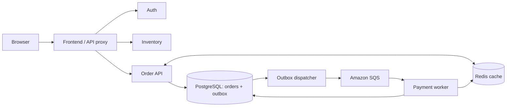
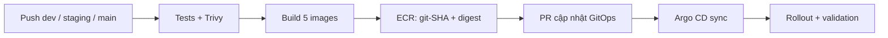

<div align="center">

# ReliabilityShop

**Ứng dụng microservices cho nền tảng AWS Cloud-Native SRE.**

Node.js 22 · PostgreSQL · Redis · Amazon SQS · GitHub Actions

[Kiến trúc](#kiến-trúc) · [Mã nguồn](#mã-nguồn) · [Phát triển](#phát-triển) · [CI/CD](#cicd) · [Platform](https://github.com/Kien-devops/aws-cloud-native-sre-platform)

</div>

---

ReliabilityShop minh họa hành trình tạo đơn hàng, ghi dữ liệu bằng transactional outbox và xử lý sự kiện bất đồng bộ. Repository này sở hữu mã ứng dụng, Dockerfile, kiểm thử và pipeline build; repository platform sở hữu cấu hình triển khai Kubernetes.

## Kiến trúc



Order và outbox được ghi trong cùng transaction. Dispatcher gửi event lên SQS; worker ghi nhận `event_id` để xử lý message lặp an toàn, cập nhật trạng thái đơn rồi mới xóa message. Redis phục vụ cache-aside; PostgreSQL giữ dữ liệu gốc.

## Mã nguồn

| Thành phần | Trách nhiệm | Điểm vào |
| --- | --- | --- |
| Frontend | Storefront, sổ đơn hàng, diagnostics và proxy API | [frontend/server.js](frontend/server.js) |
| Auth | Phát hành và kiểm tra JWT demo | [services/auth/server.js](services/auth/server.js) |
| Order | API đơn hàng, idempotency, outbox, Redis | [services/order/app.js](services/order/app.js) |
| Inventory | Danh mục và tồn kho trong bộ nhớ | [services/inventory/server.js](services/inventory/server.js) |
| Payment | Consumer SQS, chống xử lý lặp, cập nhật đơn | [services/payment/app.js](services/payment/app.js) |
| Containers | Dockerfile riêng cho 5 service | [docker/](docker/) |
| Automation | Test, scan, build và promotion | [.github/workflows/](.github/workflows/) |

## Phát triển

Cần Node.js 22. Chạy từ gốc repository:

```bash
npm ci --prefix services/order
npm ci --prefix services/payment
node --test services/auth/test.js
npm test --prefix services/order
npm test --prefix services/payment
npm test --prefix frontend
```

`npm test` tại gốc chỉ chạy auth. Order và payment cần PostgreSQL/SQS cùng cấu hình môi trường phù hợp để chạy tích hợp; Redis là dependency tùy chọn của luồng order. Repo chưa có Docker Compose dựng toàn bộ stack.

| Cấu hình | Mục đích |
| --- | --- |
| `PORT` | HTTP port, mặc định `8080` |
| `DB_HOST`, `DB_PORT`, `DB_NAME`, `DB_USER`, `DB_PASSWORD` | Kết nối PostgreSQL |
| `DB_SSL`, `DB_SSL_REJECT_UNAUTHORIZED` | TLS database và xác minh chứng chỉ |
| `REDIS_HOST`, `REDIS_PORT`, `REDIS_AUTH`, `REDIS_TLS` | Cache Redis |
| `AWS_REGION`, `SQS_QUEUE_NAME` | Vùng AWS và hàng đợi |
| `JWT_SECRET` | Khóa ký JWT |
| `ORDER_SERVICE_URL`, `INVENTORY_SERVICE_URL`, `AUTH_SERVICE_URL`, `WORKER_SERVICE_URL` | Upstream của frontend |

Giữ credentials ngoài Git. Trên EKS, platform cung cấp secret runtime và IAM role; không cần AWS access key tĩnh trong image.

## CI/CD



| Workflow | Vai trò |
| --- | --- |
| [ci.yml](.github/workflows/ci.yml) | Node tests và kiểm tra cú pháp JavaScript |
| [security-scan.yml](.github/workflows/security-scan.yml) | Trivy filesystem: vulnerability, secret, misconfiguration; bỏ qua lỗ hổng chưa có bản sửa |
| [build-push.yml](.github/workflows/build-push.yml) | Build/scan image, OIDC tới ECR, mở PR cập nhật digest vào platform |
| [update-gitops.yml](.github/workflows/update-gitops.yml) | Luồng thủ công cập nhật base; cần đối chiếu digest ở overlay |

Promotion ánh xạ `dev → dev`, `staging → staging`, `main → prod`. Source artifact là commit; build artifact là image ECR; deployment artifact là manifest GitOps pin digest. Rollback dùng digest đã biết tốt qua PR platform, kết hợp abort canary khi cần.

## Phạm vi ứng dụng

Auth hiện là demo, chưa có xác thực tài khoản đầy đủ; order API chưa áp dụng authorization. Inventory lưu trong bộ nhớ từng process. Các giới hạn này cần hoàn thiện trước khi phục vụ người dùng production.

Health API và diagnostics phản ánh runtime tại thời điểm gọi; không thay thế kiểm chứng HA, trạng thái ESO hoặc SLO dài hạn.

---

[Platform & deployment](https://github.com/Kien-devops/aws-cloud-native-sre-platform) · [GitHub Actions](https://github.com/Kien-devops/app3/actions)

